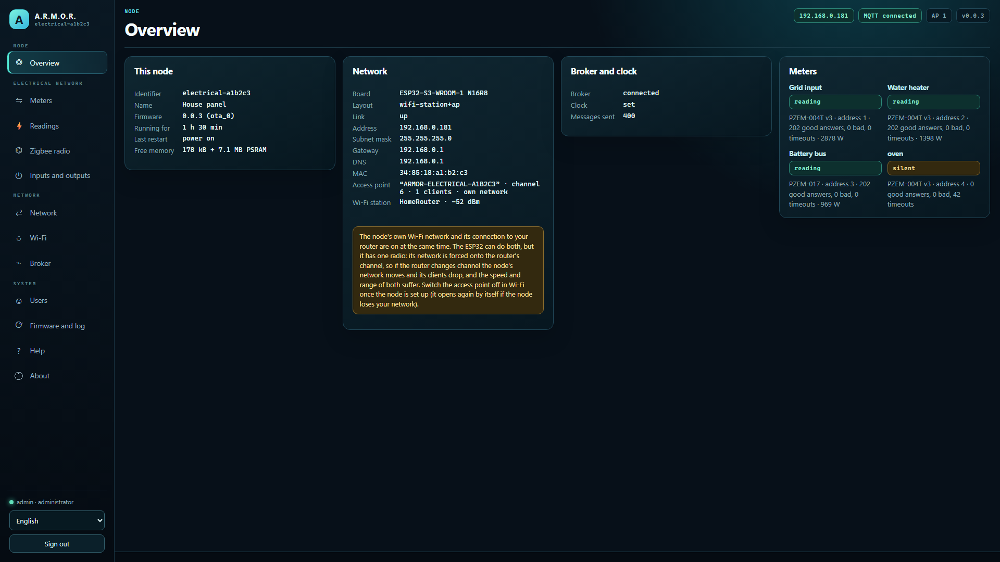
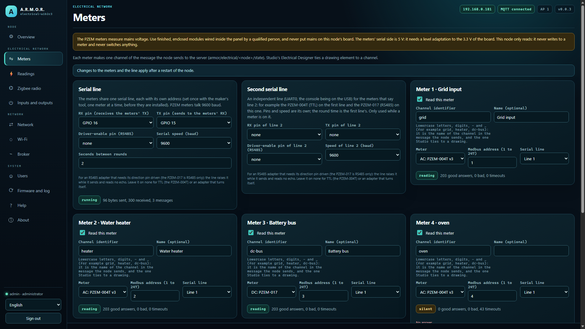
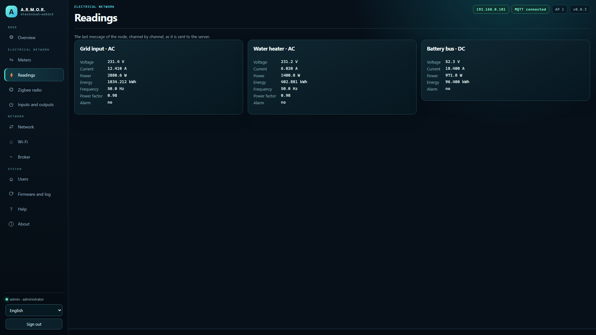
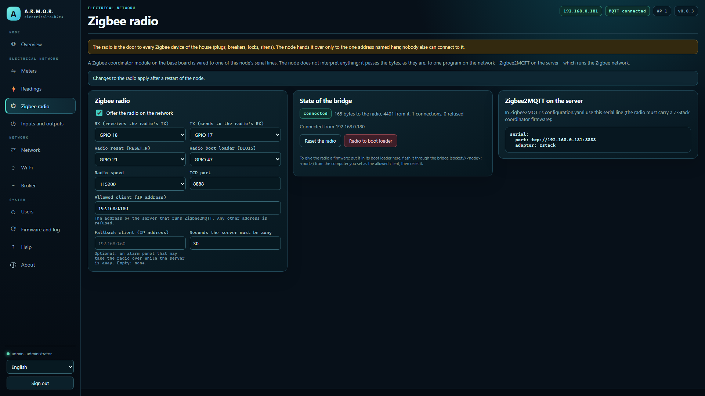

<p align="center">
  
</p>

# ⚡ ARMOR-ELECTRICAL

<p align="center">
  <a href="README.md">🇺🇸 English</a> |
  <a href="README_spa.md">🇪🇸 Español</a> |
  <a href="README_fra.md">🇫🇷 Français</a> |
  <a href="README_ita.md">🇮🇹 Italiano</a> |
  <a href="README_deu.md">🇩🇪 Deutsch</a> |
  <a href="README_zho.md">🇨🇳 简体中文</a> |
  🇯🇵 <b>日本語</b> |
  <a href="README_por.md">🇵🇹 Português</a>
</p>

### 電気ノード：住宅の AC・DC ネットワークの電圧、電流、電力、エネルギーを読み取り、その開閉のルールを持ちます（PC でテスト済みのコアとビルドできるファームウェア。基板ではまだ動作していません）

<p align="center">
  
  
  
  
  
  
</p>

---

**正直さのチェック - 今日動いているもの:** コア（PZEM-004T v3 と PZEM-017 メーターのフレーム、それらに問い合わせるバス、ノードのメッセージ、アナログ入力、切り替えのルール：11 のテストプログラムで 376,272 項目、うち 375,008 項目が切り替えルール）は代替メーターと接触器を使ってコンピューター上でテストされ、生成するメッセージは ARMOR-COMMON に受け付けられます。ノードのファームウェア（設定、シリアルライン、パネルのメーターと測定値のページ、Bluetooth、署名付きアップデート）は ESP-IDF 5.4 コンテナーで両方の基板向けにビルドできます。**基板上で動いたことはなく、メーターにも接触器にも何も接続されておらず、ここには何かを切り替えるものはありません。**

---

## 📋 ひと目で

| | |
|---|---|
| バージョン | `0.3.9` |
| 成熟度 | 機能する |
| テスト | 376,272 checks in 11 programs (`ctest`) |
| 技術 | C++17 (host-tested core); ESP-IDF firmware for the ESP32-S3 (Wi-Fi or Ethernet), with its web panel |
| 実機での確認 | まだありません：基板は未製作で、メーターも接触器も未接続。何も切り替えません |

## 🎯 概要

* **電力量計の読み取り：** Peacefair の **PZEM-004T v3**（AC）と **PZEM-017**（DC）の Modbus RTU フレーム。CRC、レジスタを読む要求、応答の解読（電圧、電流、電力、エネルギー、周波数、力率、警報）。作るのは読み取り要求だけで、電力量計に書き込むもの（アドレス、しきい値、エネルギーのリセット）はどこにも作りません。合わない応答や、実際の電力量計が出せない値を含む応答は拒否します。
* **バス：** 複数の電力量計がつながる回線には 1 台ずつタイムアウト付きで問い合わせ、それぞれの最後の正常な読み取りを保持します。応答のない電力量計は 10 秒後に公開されなくなります。
* **メッセージ** `armor/electrical/<ノード>/state`：チャンネル（回路、線、系統入力、DC バス）ごとの項目に、AC/DC、電圧、電流、電力、エネルギー、周波数、力率、ノードが見ている開閉器の状態、警報を入れます。共有契約に含まれ、状態を運び、命令は運びません。
* **開閉のルール：** ハードウェアとは別に、2 つの電源の切り替えを制御するコントローラー。両方を同時に指令せず、開閉の許可、直前のノードの武装、デッドタイム中ずっと両接触器が開と確認されていることを要求し、指令どおりの状態を示さない接触器は確認応答まで残る故障として扱います。**開閉は初期設定でオフで、どのハードウェアも駆動しません。**
* **開閉器へのコマンド（有効化していません）：** 状態メッセージにはノードの開閉器の状態を載せることができ、共有コントラクトにはコマンド（`arm`、続いて 1 回限りのトークン付きの `close_a` または `close_b`、`open`、`acknowledge`）とノードの応答があります。コアは上記のルールでそれらを読み取り応答し、共有ベクターと模擬の接触器でテスト済みです。どのファームウェアイメージにも含まれていないため接触器を動かすことはできず、ARMOR-SERVER は有効化（`ARMOR_ELECTRICAL_SWITCHING=1`）され、かつブローカーの ACL が許可しない限りコマンドを送りません。
* **見える場所：** ARMOR-STUDIO の*電気設計*が住宅のネットワークを描き、各要素にそのチャンネルの計測値を表示します。ARMOR-SERVER が読み取り値、履歴、合計を保持します。
* **ノードのファームウェア**（Wi-Fi の ESP32-S3-WROOM-1 N16R8、またはケーブル接続の Waveshare ESP32-S3-ETH）：設定、最大 16 台の電力量計のための 1 本のシリアル回線、他のノードと同じ Web パネル（セットアップ、ユーザー、Wi-Fi、ブローカー、無線アップデート、HTTPS）に電力量計ページと測定値ページを加えたもの（8 言語）。読み取り専用で、開閉のルールは組み込まれていません。[ファームウェア](docs/NODE_FIRMWARE.md)を参照。
* **スマートフォンから Bluetooth で設定：** レーダーノードと同じチャンネルです。ARMOR アプリがノードを `ARMOR-XXXXXX` として見つけ、パネルのユーザーとセットアップコードを使って、名前、Wi-Fi、アドレス、ブローカー、Bluetooth モードを設定します（[プロトコル](docs/BLE_PROVISIONING.md)）。設定を変えない限り、ノードにユーザーがいない間だけ待ち受けます。無線部分は基板ではまだ動作していません。
* **署名付きの無線アップデート：**ノードが GitHub からインストールするのは、SHA-256 が一致し、管理者の有効な Ed25519 署名を持つイメージだけです（公開鍵はファームウェア内、秘密鍵は管理者の手元から出ません）。管理者がパネルで手動アップロードしたファイルは引き続き受け付けます。パネルのページとメッセージは 8 言語です。
* **PIN 付きの Bluetooth ペアリング：**6 桁の PIN は設定コードから導出され、USB コンソールに表示され、管理者にはパネルにも表示されます。スマートフォンはこれを入力して初めてノードの設定を書き込めます。
* **まだ：** 基板上で動作するファームウェア、ハードウェア、実際の設備での計測、そして開閉。
* **パネルを使えるのは家だけ：**パネルは既定でプライベートネットワーク（または所有者が指定した VPN などのネットワーク）にだけ応答し、保存する本人を締め出す一覧は拒否します。誤ったパスワードは人ごと・アドレスごとに数え、サーバーのプロキシの背後でも動くので、ノードを公開せずに家の外から使えます。**推定値はそう示されます：** 電流入力から作られたチャンネルには `power_estimated` が付き、Studio とサーバーはその電力を推定値（電流と公称電圧からの皮相電力）として表示し、それを含む系統値にも印を付けます。
* **ブローカーとの暗号化通信(TLS、任意):** 初期状態ではオフで、ノードはこれまでどおり暗号化なしの MQTT で通信します。ブローカーページのスイッチと、設備独自の認証局の証明書(PEM、最大 2 KB)の入力欄により、`mqtts://` で接続し、その認証局だけを信頼し、到達したアドレス向けに発行された証明書かを確認します。PEM 証明書 1 つでないものは拒否されます。ホストテストで検証済みで、ハンドシェイクはまだ基板では実行していません。
* **状態報告:** ノードは約 1 分ごとに、稼働時間と直前の再起動の理由、空きメモリ、回線と Wi-Fi 信号、ブローカーへの接続回数、最後に記録したエラーを公開します（`armor/health/<ノード>`、ARMOR-COMMON の `node_health` 契約）。作成するコードは全ノードで共有され、コンピューター上でテストされていますが、ボード上ではまだ動作していません。

## 🖼️ スクリーンショット

テストベンチで 1920×1080 で撮影。サンプルデータを使用しており、実際の設備は接続されていません。

<table>
<tr><td width="50%" valign="top"><br><sub>概要：ネットワーク、ブローカー、ファームウェア、報告内容など、ノードの状態をひと目で確認できます。</sub></td><td width="50%" valign="top"><br><sub>メーター：ノードが読み取る電力量計とアナログチャネル。名前とスケールを設定できます。</sub></td></tr>
<tr><td width="50%" valign="top"><br><sub>測定値：ノードがいま読み取っている値と、各値の経過時間。</sub></td><td width="50%" valign="top"><br><sub>Zigbee 無線：コーディネーターモジュールへのシリアルブリッジ、使用を許可するクライアント、ブリッジの状態。</sub></td></tr>
</table>

## 🧩 A.R.M.O.R. での役割

ARMOR-ELECTRICAL はメーターで家の AC・DC ネットワークを測定し、電源間の切り替えのルールを保持します。測定値を [ARMOR-SERVER](https://github.com/JuanenRac/ARMOR-SERVER) に送ると、サーバーが履歴と日ごとのエネルギーを保持して警報を出し、[ARMOR-STUDIO](https://github.com/JuanenRac/ARMOR-STUDIO) の*電気*メニューと*電気デザイナー*、[ARMOR-ANDROID-CONTROL](https://github.com/JuanenRac/ARMOR-ANDROID-CONTROL) の電気画面が表示します。切り替えは設計済み（待機、1 回限りのトークン、インターロック、両方の接触器の確認）ですが、有効化はされていません。

## 📂 リポジトリの構成

```text
ARMOR-ELECTRICAL/
├── main/    the ESP-IDF component: app_main, electrical_manager (the task), uart_bus, network, web_server, api_shared, mqtt_link, node_store, tls_cert, ble_provision, board_ethernet
├── core/    pzem (frames of the PZEM meters), pzem_bus (the line), meter_runner (one turn of the loop), electrical_json (the message), electrical_config (the settings),
│            interlock (the rules for switching, NOT linked into the firmware), ble_frame + ble_dispatch (Bluetooth), auth, netplan, board_s3, json...
├── panel/   the web panel: index.html, app.js, text.js (8 languages), style.css
├── tools/   build_node.sh, pack_panel.py, panel_mock.mjs, panel_browser_test.mjs
├── tests/   test_meters, test_runner, test_config, test_mqtt_tls, test_ble, test_interlock, emit_samples + check_samples.py (the messages against ARMOR-COMMON)
├── docs/    DESIGN, NODE_FIRMWARE, BLE_PROVISIONING, SAFETY, SWITCHING, PROTOCOLS, ELECTRICAL_MESSAGES, HARDWARE
└── images/  brand assets
```

## 🛠️ 開発環境

**必要なもの:** a C++17 compiler for the host tests, the ESP-IDF 5.4 container to build the image, an ESP32-S3-WROOM-1 N16R8 or a Waveshare ESP32-S3-ETH

```bash
cmake -S tests -B build/host && cmake --build build/host && ctest --test-dir build/host   # 376,272 checks: the meters (62), the loop that asks them (72), the settings (85), the readings and inputs (477), Bluetooth (68), the shared base (252), the central link (19), the release and signature checks (20), the interlock (135,736) and the switch sets (239,272)
build/host/emit_samples | python tests/check_samples.py                                     # the messages, against ARMOR-COMMON
node tools/panel_mock.mjs --user admin:adminpass123                                         # the panel without a board
tools/build_node.sh generic                                                                 # the firmware image for the N16R8 board in the ESP-IDF container: dist/generic-s3-wifi.bin
tools/build_node.sh generic s3-eth                                                          # the same firmware for the Waveshare ESP32-S3-ETH (Ethernet)
```

See the [firmware guide](docs/NODE_FIRMWARE.md) and the [Bluetooth channel](docs/BLE_PROVISIONING.md).

[設計](docs/DESIGN.md)、[安全に関する注意](docs/SAFETY.md)、[開閉のルール](docs/SWITCHING.md)、[プロトコル](docs/PROTOCOLS.md)、[メッセージ](docs/ELECTRICAL_MESSAGES.md)を参照してください。

## 🔗 関連プロジェクト

**A.R.M.O.R.**（Autonomous Radar & Multimodal Observation Range）は、独立したリポジトリで構成される周辺警備システムです。それぞれに独自のバージョン、テスト、README があります。ファミリーは次のとおりです：

* **[ARMOR-COMMON](https://github.com/JuanenRac/ARMOR-COMMON)** - メッセージ契約、検証器、適合性ベクトル、生成された型
* **[ARMOR-RADAR](https://github.com/JuanenRac/ARMOR-RADAR)** - ESP32-S3 用フィールドノードのファームウェア。レーダー 3 基と独自の Web パネル付き
* **[ARMOR-SOLAR](https://github.com/JuanenRac/ARMOR-SOLAR)** - 太陽光インバーターとバッテリーのプロトコル、およびゲートウェイノードのメッセージ
* **ARMOR-ELECTRICAL** (このリポジトリ) - 電気ノード：電力量計、電力網の計測メッセージ、開閉のルール
* **[ARMOR-ALARM](https://github.com/JuanenRac/ARMOR-ALARM)** - 警報ノードと警報盤：警戒区域、警戒セット、遅延、サイレン、PIN。サーバーがあってもなくても
* **[ARMOR-HMI](https://github.com/JuanenRac/ARMOR-HMI)** - タッチパネル：壁面ディスプレイでのシステム状態表示、警戒・確認操作、音声アシスタントの拠点
* **[ARMOR-NETWORK](https://github.com/JuanenRac/ARMOR-NETWORK)** - ローカルネットワーク：機器、インターネット、そして変化
* **[ARMOR-SERVER](https://github.com/JuanenRac/ARMOR-SERVER)** - 中央コーディネーター：テレメトリ、アラーム、デバイス、太陽光の測定値、カメラ
* **[ARMOR-STUDIO](https://github.com/JuanenRac/ARMOR-STUDIO)** - Web コンソール：カメラ、レーダー、アラーム、太陽光発電、2D/3D サイト設計
* **[ARMOR-ANDROID-CONTROL](https://github.com/JuanenRac/ARMOR-ANDROID-CONTROL)** - リアルタイム 2D/3D レーダー付きの Android オペレータークライアント
* **[ARMOR-SERVER-AI](https://github.com/JuanenRac/ARMOR-SERVER-AI)** - 判断を説明し、決して動作しない視覚推論ポリシー
* **[ARMOR-VISION](https://github.com/JuanenRac/ARMOR-VISION)** - Jetson Orin NX 向けのカメラのゾーン、マスク、検知ルール
* **[ARMOR-VOICE-AI](https://github.com/JuanenRac/ARMOR-VOICE-AI)** - 偽造できない確認を備えたオフライン音声インテント
* **[ARMOR-HARDWARE](https://github.com/JuanenRac/ARMOR-HARDWARE)** - 筐体、電子部品、ベンチ受け入れマトリクス
* **[ARMOR-DEVOPS](https://github.com/JuanenRac/ARMOR-DEVOPS)** - デプロイ、CM5 テストベンチ、バックアップ、TLS
* **[ARMOR-SIMULATOR](https://github.com/JuanenRac/ARMOR-SIMULATOR)** - 再現可能な故障を備えたオフラインのテレメトリシミュレーター
* **[ARMOR-UPDATER](https://github.com/JuanenRac/ARMOR-UPDATER)** - エコシステム自身のリポジトリを検出し、インストールし、更新する
* **[ARMOR-DOCS](https://github.com/JuanenRac/ARMOR-DOCS)** - アーキテクチャ、セキュリティ基準、機能マトリクス

## 📚 ドキュメントとコミュニティ

詳しくは：

* [機能マトリクス：実証済みのものとそうでないもの](https://github.com/JuanenRac/ARMOR-DOCS/blob/main/docs/CAPABILITY_MATRIX.md)
* [プロジェクト一覧：バージョンとリポジトリ間の依存関係](https://github.com/JuanenRac/ARMOR-DOCS/blob/main/docs/PROJECT_CATALOG.md)
* [このリポジトリの変更履歴](CHANGELOG.md)
* [ライセンス（GPL-3.0-or-later）](LICENSE)
* 質問・提案・報告：electrohobby3d@gmail.com

## 👤 作者

**JuanenRac (Electro Hobby 3D)** · electrohobby3d@gmail.com

## 📜 ライセンス

GPL-3.0-or-later - [LICENSE](LICENSE) を参照。
